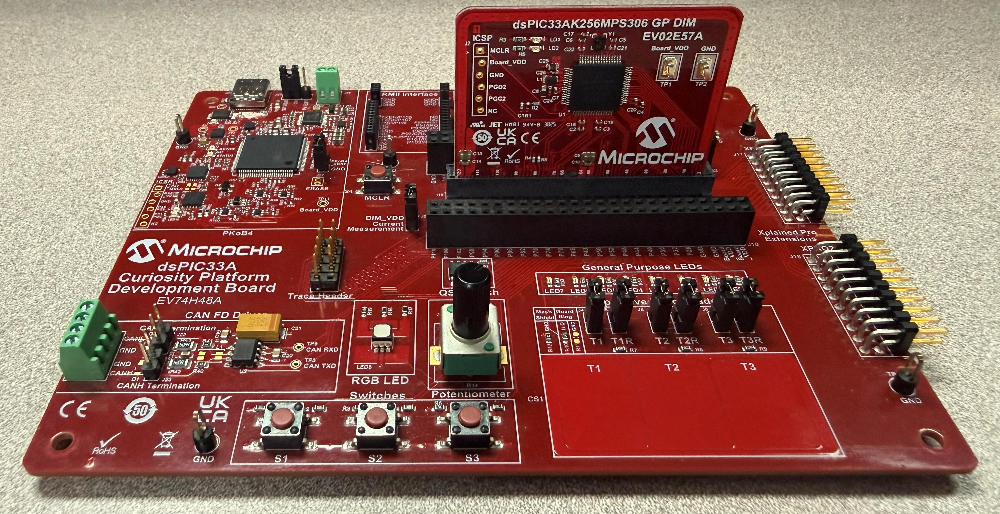

<picture>
    <source media="(prefers-color-scheme: dark)" srcset="../../images/microchip_logo_white_red.png">
    <source media="(prefers-color-scheme: light)" srcset="../../images/microchip_logo_black_red.png">
    
</picture>

# Crypto Accelerator Module Hash Example Application
- Crypto Accelerator Module will be referred to as CAM throughout the remainder of the document. 

## Description
This example application utilizes the Crypto Library that interacts with the Pre-compiled CAM Hardware Driver to perform SHA hash operations using different sized input vectors. Two separate MPLAB X projects are provided: one for SHA/SHA-3 fixed-length digest algorithms and one for SHAKE extendable-output functions.

### SHA Project (`dspic33ak256mps306-sha.X`)
The following hash algorithms are supported:
- SHA-1
- SHA-224
- SHA-256
- SHA-384
- SHA-512
- SHA3-224
- SHA3-256
- SHA3-384
- SHA3-512

### SHAKE Project (`dspic33ak256mps306-shake.X`)
The following extendable-output functions are supported:
- SHAKE-128
- SHAKE-256

## Software Tool Versions Used
- dsPIC33AK-MP_DFP v1.3.185
- MPLAB® X IDE [v6.30](https://www.microchip.com/mplab-x-ide)
- MPLAB® XC-DSC Compiler [v3.31](https://www.microchip.com/xcdsc)

## Setting Up The Hardware
- dsPIC33AK256MPS306 Curiosity GP DIM ([EV02E57A](https://www.microchip.com/en-us/development-tool/EV02E57A))
- Curiosity Platform Development Board ([EV74H48A](https://www.microchip.com/EV74H48A))

1. Insert the dsPIC33AK256MPS306 DIM into the DIM J1 slot on the Curiosity Platform Development Board.
2. Connect the board from the J24 USB-C PKoB4 (PICKit™ On-Board 4) to the computer.



## Running The Application

### SHA Project
1. Within MPLAB® X IDE, open the `dspic33ak256mps306-sha.X` application project. 
    - (Optional) To run all added test vectors uncomment the RUN_ALL_VECTORS definition on line 61 in dspic33ak256mps306-sha.X/app/app_sha.h
2. Build and Program the application using MPLAB® X IDE.
3. The printed information can be found on the serial COM port reading at a speed of 115200.

### SHAKE Project
1. Within MPLAB® X IDE, open the `dspic33ak256mps306-shake.X` application project.
    - (Optional) To run all added test vectors uncomment the RUN_ALL_VECTORS definition on line 61 in dspic33ak256mps306-shake.X/app/app_shake.h
2. Build and Program the application using MPLAB® X IDE.
3. The printed information can be found on the serial COM port reading at a speed of 115200.

## Application Results

### SHA/SHA-3 Results
The following information will be printed on the COM port for all supported SHA and SHA-3 algorithms:
1. A header is displayed showing the used SHA algorithm and input data length.
2. The input data is printed out.
3. The result digest data is printed out using the single-step API.
4. The result digest data is printed out using the multi-step API. Various block sizes are used.
5. After each test, an XOR comparison is completed of the result and expected digests. Pass or Fail is printed out depending on the comparison result.

### SHAKE Results
The following information will be printed on the COM port for all supported SHAKE algorithms:
1. A header is displayed showing the used SHAKE algorithm and input data length.
2. The input data is printed out.
3. The result digest data is printed out using the single-step API.
4. The result digest data is printed out using the multi-step API. Various block sizes are used.
5. After each test, a comparison is completed of the result and expected digests. Pass or Fail is printed out depending on the comparison result.

## Crypto Library APIs

### SHA/SHA-3 APIs
crypto_hash.h defines Digest, Init, Update, Final, and GetHashAndHashSize APIs.

```c
crypto_Hash_Status_E Crypto_Hash_Sha_Digest(
    crypto_HandlerType_E shaHandler_en,    // configure Crypto API to use hardware acceleration
    uint8_t *ptr_data,                     // pointer to the input data array to be hashed
    uint32_t dataLen,                      // length of the input data array
    uint8_t *ptr_digest,                   // pointer to the data array for result hash to be stored
    crypto_Hash_Algo_E shaAlgorithm_en,    // configure Crypto API for desired SHA algorithm
    uint32_t shaSessionId                  // session ID for use by Crypto API (maximum of 1)
);
```

```c
crypto_Hash_Status_E Crypto_Hash_Sha_Init(
    st_Crypto_Hash_Sha_Ctx *ptr_shaCtx_st, // SHA configuration context
    crypto_Hash_Algo_E shaAlgorithm_en,    // configure Crypto API for desired SHA algorithm
    crypto_HandlerType_E shaHandler_en,    // configure Crypto API to use hardware acceleration
    uint32_t shaSessionId                  // session ID for use by Crypto API (maximum of 1)
);
```

```c
crypto_Hash_Status_E Crypto_Hash_Sha_Update(
    st_Crypto_Hash_Sha_Ctx *ptr_shaCtx_st, // SHA configuration context
    uint8_t *ptr_data,                     // pointer to the input data array to be hashed
    uint32_t dataLen                       // length of the input data array
);
```

```c
crypto_Hash_Status_E Crypto_Hash_Sha_Final(
    st_Crypto_Hash_Sha_Ctx *ptr_shaCtx_st, // SHA configuration context
    uint8_t *ptr_digest                    // pointer to the data array for result digest to be stored
);
```

### SHAKE APIs
crypto_hash.h defines Digest, Init, Update, and Final APIs for SHAKE extendable-output functions.

```c
crypto_Hash_Status_E Crypto_Hash_Shake_Digest(
    crypto_HandlerType_E shakeHandlerType_en,  // configure Crypto API to use hardware acceleration
    crypto_Hash_Algo_E shakeAlgorithm_en,      // configure Crypto API for desired SHAKE algorithm
    uint8_t *ptr_data,                         // pointer to the input data array to be hashed
    uint32_t dataLen,                          // length of the input data array
    uint8_t *ptr_digest,                       // pointer to the data array for result digest to be stored
    uint32_t digestLen,                        // length of the desired digest output
    uint32_t shakeSessionId                    // session ID for use by Crypto API (maximum of 1)
);
```

```c
crypto_Hash_Status_E Crypto_Hash_Shake_Init(
    st_Crypto_Hash_Shake_Ctx *ptr_shakeCtx_st, // SHAKE configuration context
    crypto_Hash_Algo_E shakeAlgorithm_en,      // configure Crypto API for desired SHAKE algorithm
    crypto_HandlerType_E shakeHandlerType_en,  // configure Crypto API to use hardware acceleration
    uint32_t digestLen,                        // length of the desired digest output
    uint32_t shakeSessionId                    // session ID for use by Crypto API (maximum of 1)
);
```

```c
crypto_Hash_Status_E Crypto_Hash_Shake_Update(
    st_Crypto_Hash_Shake_Ctx *ptr_shakeCtx_st, // SHAKE configuration context
    uint8_t *ptr_data,                         // pointer to the input data array to be hashed
    uint32_t dataLen                           // length of the input data array
);
```

```c
crypto_Hash_Status_E Crypto_Hash_Shake_Final(
    st_Crypto_Hash_Shake_Ctx *ptr_shakeCtx_st, // SHAKE configuration context
    uint8_t *ptr_digest                        // pointer to the data array for result digest to be stored
);
```

## Benchmarking

### Performance Benchmarking
The following benchmarking results were obtained with the device clock speed set to 200MHz.

#### SHA/SHA-3
|Hash Algorithm|Input Size (bytes)|Crypto_Hash_Sha_Digest Performance (Mbps)|
|----|----|----|
|SHA-1|8,192|TBD|
|SHA-224|8,192|TBD|
|SHA-256|8,192|TBD|
|SHA-384|8,192|TBD|
|SHA-512|8,192|TBD|
|SHA3-224|8,192|TBD|
|SHA3-256|8,192|TBD|
|SHA3-384|8,192|TBD|
|SHA3-512|8,192|TBD|

#### SHAKE
|Hash Algorithm|Input Size (bytes)|Digest Size (bytes)|Crypto_Hash_Shake_Digest Performance (Mbps)|
|----|----|----|----|
|SHAKE-128|8,192|TBD|TBD|
|SHAKE-256|8,192|TBD|TBD|

### Memory Size Benchmarking

#### Single Step

|Hash Algorithm|FLASH (bytes)|RAM Static (bytes)|RAM Stack (bytes)|
|----|----|----|----|
|SHA-1|TBD|TBD|TBD|
|SHA-224|TBD|TBD|TBD|
|SHA-256|TBD|TBD|TBD|
|SHA-384|TBD|TBD|TBD|
|SHA-512|TBD|TBD|TBD|
|SHA3-224|TBD|TBD|TBD|
|SHA3-256|TBD|TBD|TBD|
|SHA3-384|TBD|TBD|TBD|
|SHA3-512|TBD|TBD|TBD|
|SHAKE-128|TBD|TBD|TBD|
|SHAKE-256|TBD|TBD|TBD|

#### Multi Step

|Hash Algorithm|FLASH (bytes)|RAM Static (bytes)|RAM Stack (bytes)|
|----|----|----|----|
|SHA-1|TBD|TBD|TBD|
|SHA-224|TBD|TBD|TBD|
|SHA-256|TBD|TBD|TBD|
|SHA-384|TBD|TBD|TBD|
|SHA-512|TBD|TBD|TBD|
|SHA3-224|TBD|TBD|TBD|
|SHA3-256|TBD|TBD|TBD|
|SHA3-384|TBD|TBD|TBD|
|SHA3-512|TBD|TBD|TBD|
|SHAKE-128|TBD|TBD|TBD|
|SHAKE-256|TBD|TBD|TBD|

## ACVP
The APIs have been self-tested according to the NIST ACVP specification and generated test vectors. More information can be found [here](https://pages.nist.gov/ACVP/).
