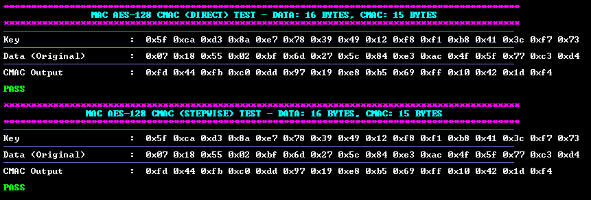
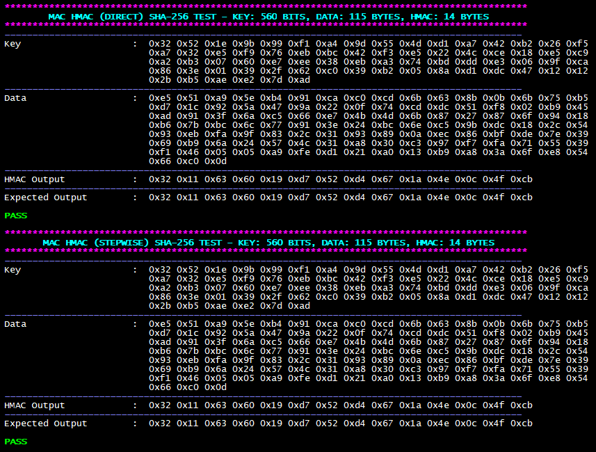

<picture>
    <source media="(prefers-color-scheme: dark)" srcset="../../images/microchip_logo_white_red.png">
    <source media="(prefers-color-scheme: light)" srcset="../../images/microchip_logo_black_red.png">
    
</picture>

# Crypto Accelerator Module Message authentication Code (MAC) Example Application
- Crypto Accelerator Module will be referred to as CAM throughout the remainder of the document.

## Description
This example application utilizes the Crypto Library that interacts with the Pre-compiled CAM Hardware Driver to perform MAC operations using different sized input vectors. The following MAC algorithms are supported:
- AES-CMAC
- HMAC

## Software Tool Versions
- dsPIC33AK-MP_DEV_DFP v1.0.81
- MPLAB® X IDE [v6.25 or newer](https://www.microchip.com/mplab-x-ide)
- MPLAB® XC-DSC Compiler [v3.21 or newer](https://www.microchip.com/xcdsc)

## Setting Up The Hardware
- dsPIC33AK512MPS512 Curiosity GP DIM ([EV80L65A](https://www.microchip.com/en-us/development-tool/EV80L65A))
- Curiosity Platform Development Board ([EV74H48A](https://www.microchip.com/EV74H48A))

1. Insert the dsPIC33AK512MPS512 DIM into the DIM J1 slot on the Curiosity Platform Development Board.
2. Connect the board from the J24 USB-C PKoB4 (PICKit™ On-Board 4) to the computer.


## Running the Application
1. Within MPLAB® X IDE, open the mac.X application project.
    - (Optional) To run all added test vectors uncomment the RUN_ALL_VECTORS definition on line 73 in mac/mac.X/app_mac.h
2. Build and Program the application using MPLAB® X IDE.
3. The printed information can be found on the serial COM port reading at a speed of 115200.

## Application Results

### AES-CMAC
The following information will be printed on the COM port for AES-CMAC algorithms:
1. A header is displayed showing the used AES-CMAC algorithm and input message length.
2. The MAC is generated using the single-step API.
    1. The key data is printed out.
    2. The input data is printed out.
    3. The MAC is printed out.
    4. The result MAC and expected MAC are compared.
    5. Pass or Fail is printed out depending on the comparison result.
3. The MAC is generated using the multi-step API.
    1. The key data is printed out.
    2. The input data is printed out.
    3. The MAC is printed out.
    4. The result MAC and expected MAC are compared.
    5. Pass or Fail is printed out depending on the comparison result.



### HMAC
The following information will be printed on the COM port for HMAC algorithms:
1. A header is displayed showing the used SHA algorithm, key size and input message length.
2. The MAC is generated using the single-step API.
    1. The key data is printed out.
    2. The input data is printed out.
    3. The MAC is printed out.
    4. The result MAC and expected MAC are compared.
    5. Pass or Fail is printed out depending on the comparison result.
3. The MAC is generated using the multi-step API.
    1. The key data is printed out.
    2. The input data is printed out.
    3. The MAC is printed out.
    4. The result MAC and expected MAC are compared.
    5. Pass or Fail is printed out depending on the comparison result.



## Crypto Library APIs
### AES MAC APIs
crypto_mac_cipher.h defines Init, Cipher, Final, and Direct APIs.

```c
crypto_Mac_Status_E Crypto_Mac_AesCmac_Init(
    st_Crypto_Mac_Aes_ctx *ptr_macCmacCtx_st,   // CMAC context structure used to store values
    crypto_HandlerType_E handlerType_en,        // configure Crypto API to use hardware acceleration
    uint8_t *ptr_key,                           // pointer to the key data array to be used
    uint32_t keyLen,                            // length of the key data array
    uint32_t sessionID                          // session ID for use by the Crypto API (maximum of 1)
);
```

```c
crypto_Mac_Status_E Crypto_Mac_AesCmac_Cipher(
    st_Crypto_Mac_Aes_ctx *ptr_macCmacCtx_st,   // CMAC context structure used to store values
    uint8_t *ptr_inputData,                     // pointer to the input message to generate CMAC with
    uint32_t dataLen                            // length of the input message
);
```

```c
crypto_Mac_Status_E Crypto_Mac_AesCmac_Final(
    st_Crypto_Mac_Aes_ctx *ptr_macCmacCtx_st,   // CMAC context structure used to store values
    uint8_t *ptr_outMac,                        // output pointer to generate the CMAC to
    uint32_t macLen                             // length of the requested CMAC
);
```

```c
crypto_Mac_Status_E Crypto_Mac_AesCmac_Direct(
    crypto_HandlerType_E macHandlerType_en,     // configure Crypto API to use hardware acceleration
    uint8_t *ptr_inputData,                     // pointer to the input message to generate CMAC with
    uint32_t dataLen,                           // length of the input message
    uint8_t *ptr_outMac,                        // output pointer to generate the CMAC to
    uint32_t macLen,                            // length of the requested CMAC
    uint8_t *ptr_key,                           // pointer to the key data array to be used
    uint32_t keyLen,                            // length of the key data array
    uint32_t sessionID                          // session ID for use by the Crypto API (maximum of 1)
);
```


### HMAC APIs
crypto_mac_cipher.h defines Init, Cipher, Final, and Direct APIs.

```c
crypto_Mac_Status_E Crypto_Mac_Hmac_Init(
    st_Crypto_Mac_Hmac_ctx *ptr_hmacCtx_st,     // HMAC context structure used to store values
    crypto_HandlerType_E handlerType_en,        // configure Crypto API to use hardware acceleration
    uint8_t *ptr_key,                           // pointer to the key data array to be used
    uint32_t keyLen,                            // length of the key data array
    crypto_Hash_Algo_E hashType_en,             // hash algorithm to use for hashing
    uint32_t sessionID                          // session ID for use by the Crypto API (maximum of 1)
);
```

```c
crypto_Mac_Status_E Crypto_Mac_Hmac_Cipher(
    st_Crypto_Mac_Hmac_ctx *ptr_hmacCtx_st,     // HMAC context structure used to store values
    uint8_t *ptr_inputData,                     // pointer to the input message to generate HMAC with
    uint32_t dataLen                            // length of the input message
);
```

```c
crypto_Mac_Status_E Crypto_Mac_Hmac_Final(
    st_Crypto_Mac_Hmac_ctx *ptr_hmacCtx_st,     // HMAC context structure used to store values
    uint8_t *ptr_outMac                         // output pointer to generate the HMAC to
);
```

```c
crypto_Mac_Status_E Crypto_Mac_Hmac_Direct(
    crypto_HandlerType_E handlerType_en,        // configure Crypto API to use hardware acceleration
    uint8_t *ptr_inputData,                     // pointer to the input message to generate HMAC with
    uint32_t dataLen,                           // length of the input message
    uint8_t *ptr_outMac,                        // output pointer to generate the HMAC to
    uint8_t *ptr_key,                           // pointer to the key data array to be used
    uint32_t keyLen,                            // length of the key data array
    crypto_Hash_Algo_E hashType_en,             // hash algorithm to use for hashing
    uint32_t sessionID                          // session ID for use by the Crypto API (maximum of 1)
);
```

## Benchmarking

### Performance Benchmarking
The following benchmarking results were obtained with the device clock speed set to 200MHz.

#### AES-CMAC
|Key Size (bytes)|Plaintext Size (bytes)|MAC Size (bytes)|AES-CMAC Crypto_Mac_AesCmac_Direct Performance (Mbps)|
|----|----|----|----|
|16|8,192|16|21.56|
|24|8,192|16|21.41|
|32|8,192|16|21.13|

### Memory Size Benchmarking
The following results include usage of ECB, CTR, GCM, XTS, and CMAC APIs. Flash size will vary based on size of the stored data inputs used with the library.

#### Single Step

|Mode|RAM (bytes)|FLASH (bytes)|
|----|----|----|
|AES-CMAC|58|10,736|

#### Multi Step

|Mode|RAM (bytes)|FLASH (bytes)|
|----|----|----|
|AES-CMAC|586|10,792|

## ACVP
The APIs have been self-tested according to the NIST ACVP specification and generated test vectors. More information can be found [here](https://pages.nist.gov/ACVP/).